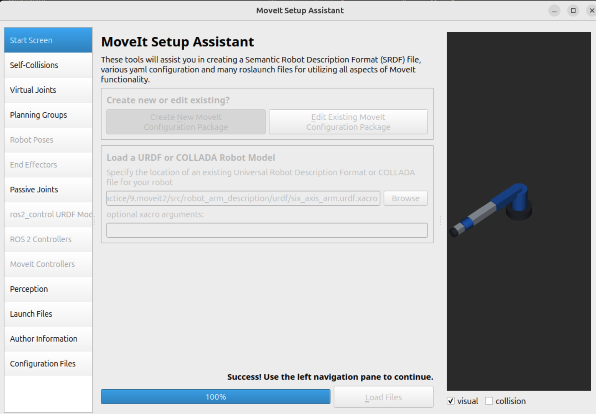
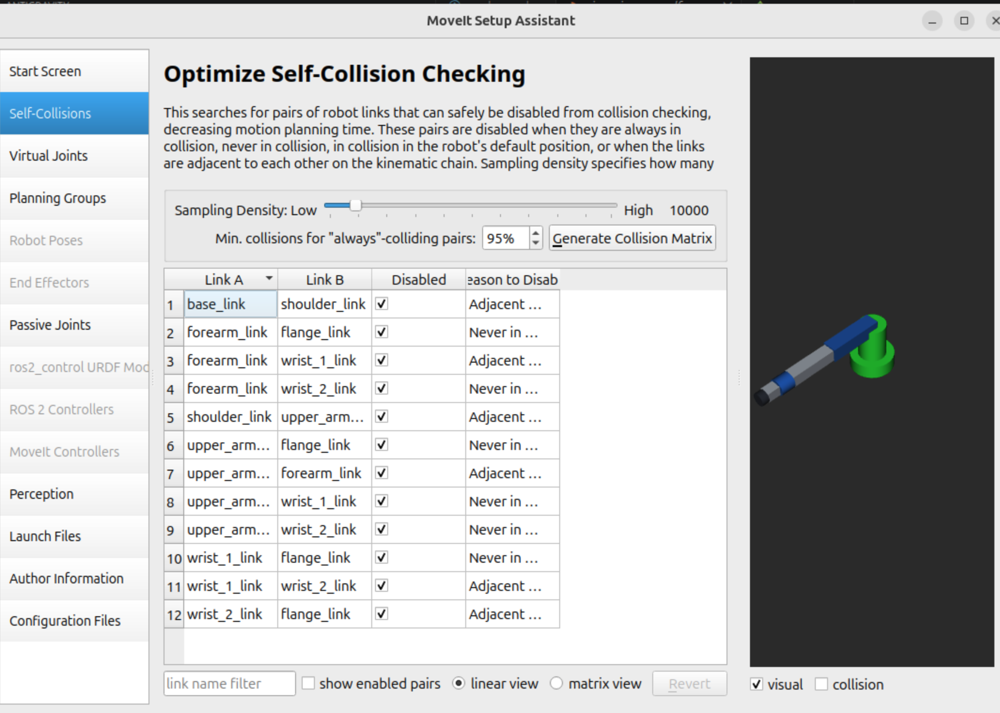
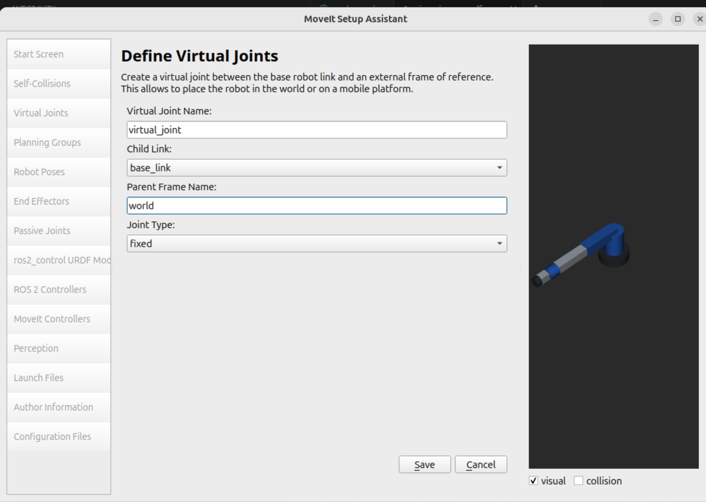
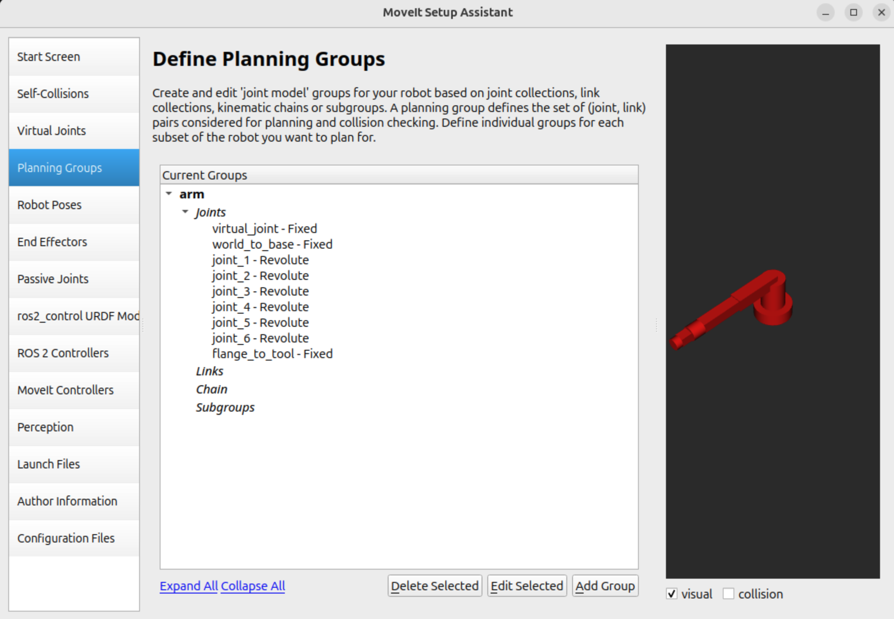
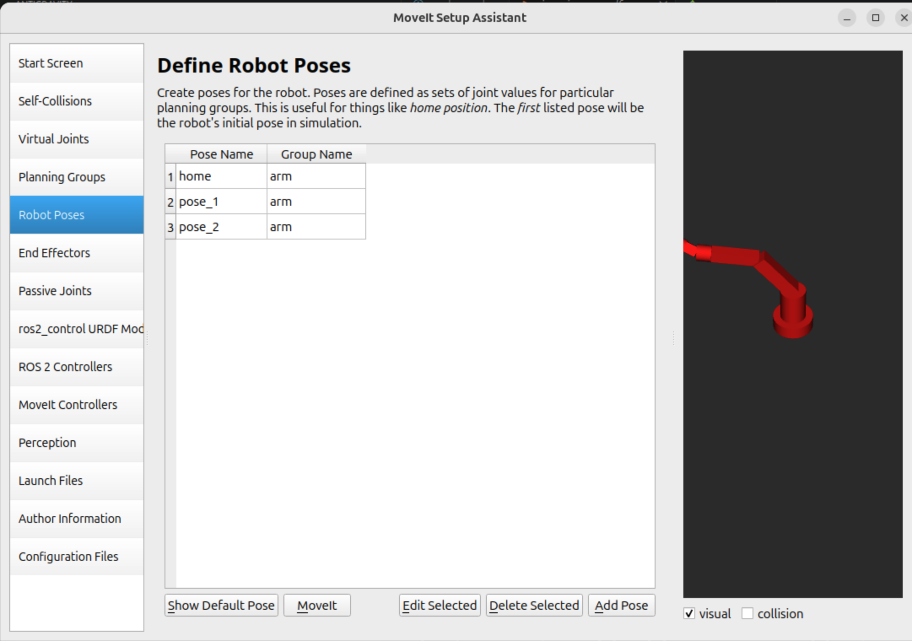
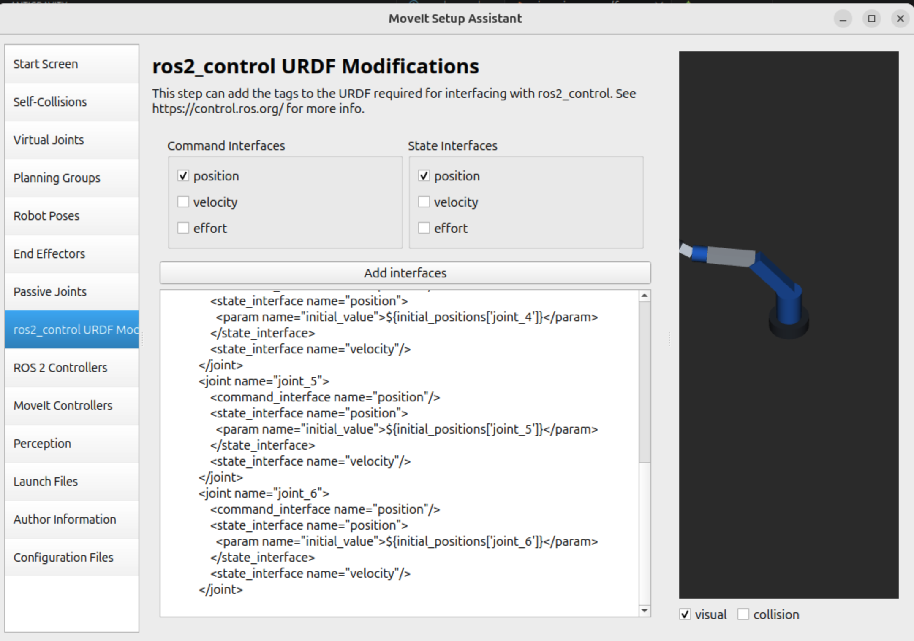
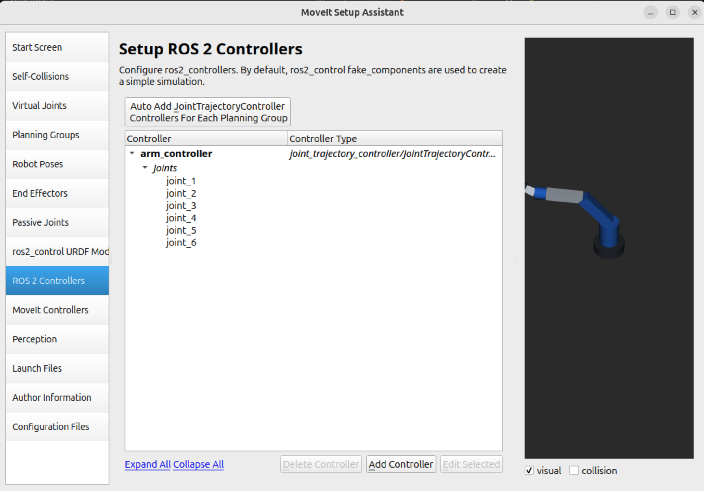
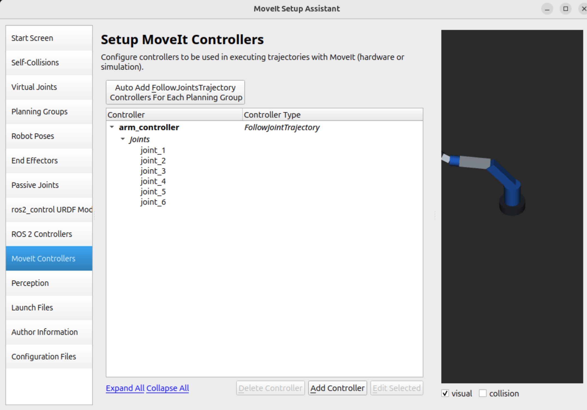
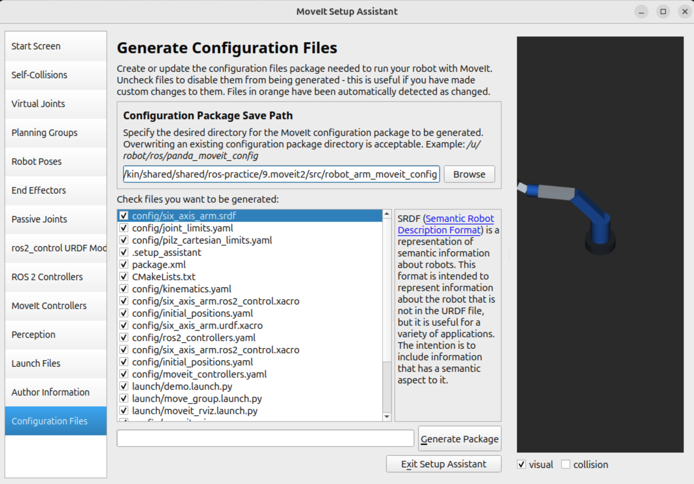

# MoveIt 2 — Six-Axis Arm & Parallel Gripper

ROS 2 Jazzy workspace for a 6-DOF robot arm with a parallel 2-finger gripper, configured with MoveIt 2, `ros2_control`, custom action servers, and optional Dynamixel XL330 hardware support.

## Contents

- [Workspace Packages](#workspace-packages)
- [1. Prerequisites](#1-prerequisites)
- [2. Build the Workspace](#2-build-the-workspace)
- [3. Quick Start](#3-quick-start)
- [4. Controlling the Arm & Gripper](#4-controlling-the-arm--gripper)
- [5. Robot & Gripper Reference](#5-robot--gripper-reference)
- [6. MoveIt Setup Assistant Guide](#6-moveit-setup-assistant-guide)

---

## Workspace Packages

| Package | Purpose |
| --- | --- |
| `robot_arm_description` | URDF/Xacro model (`six_axis_arm.urdf.xacro`) and RViz preview launch (`display.launch.py`) |
| `robot_arm_moveit_config` | MoveIt 2 configuration (SRDF, kinematics, controllers, `ros2_control`, `demo.launch.py`) |
| `robot_arm_interface` | Custom ROS 2 actions (`MoveArm`, `ControlGripper`) |
| `robot_arm_commander_cpp` | C++ MoveIt action server (`commander`) and standalone example (`test_moveit`) |
| `robot_arm_hardware` | `ros2_control` hardware interface (`arm_hardware/ArmHardwareInterface`) for Dynamixel XL330 |

---

## 1. Prerequisites

Install MoveIt 2 and CycloneDDS (recommended RMW for MoveIt 2):

```bash
sudo apt update
sudo apt install ros-$ROS_DISTRO-rmw-cyclonedds-cpp ros-jazzy-moveit
```

Set CycloneDDS as your default RMW implementation in `~/.bashrc`:

```bash
echo 'export RMW_IMPLEMENTATION=rmw_cyclonedds_cpp' >> ~/.bashrc
source ~/.bashrc
```

---

## 2. Build the Workspace

From `9.moveit2` in a ROS 2 Jazzy terminal:

```bash
source /opt/ros/jazzy/setup.bash
rosdep install --from-paths src --ignore-src -r -y
colcon build --symlink-install
source install/setup.bash
```

> **Note:** Rebuild (`colcon build --symlink-install`) and re-source `install/setup.bash` whenever you modify URDF/Xacro or MoveIt config files.

---

## 3. Quick Start

### Option A: Preview the URDF Only (`robot_arm_description`)

Opens RViz with the Joint State Publisher GUI sliders (enable the **TF** display in RViz to inspect frames):

```bash
ros2 launch robot_arm_description display.launch.py
```

To view the zero pose without GUI sliders:

```bash
ros2 launch robot_arm_description display.launch.py gui:=false
```

### Option B: Run the MoveIt 2 Demo (`robot_arm_moveit_config`)

Launches MoveIt 2 (`move_group`), RViz MotionPlanning, `ros2_control` (mock hardware by default), and the `commander` action server node:

```bash
ros2 launch robot_arm_moveit_config demo.launch.py
```

#### Launch Arguments

| Argument | Default | Description |
| --- | --- | --- |
| `launch_commander` | `true` | Launch the `robot_arm_commander_cpp` `commander` action server |
| `use_hardware` | `false` | Use real Dynamixel XL330 hardware instead of `mock_components` |
| `dynamixel_port` | `/dev/ttyUSB0` | Serial port for the Dynamixel XL330 bus |
| `baud_rate` | `57600` | Baud rate for the Dynamixel XL330 bus |

Example with real Dynamixel hardware:

```bash
ros2 launch robot_arm_moveit_config demo.launch.py use_hardware:=true dynamixel_port:=/dev/ttyUSB0 baud_rate:=57600
```

### Option C: Run the Standalone C++ Test (`test_moveit`)

Launch the MoveIt demo without `commander`, then run `test_moveit` in a second sourced terminal:

```bash
# Terminal 1
ros2 launch robot_arm_moveit_config demo.launch.py launch_commander:=false

# Terminal 2
ros2 run robot_arm_commander_cpp test_moveit
```

---

## 4. Controlling the Arm & Gripper

When `demo.launch.py` runs with `launch_commander:=true` (default), the `commander` node exposes two ROS 2 action servers from `robot_arm_interface`:

- `/move_arm` (`robot_arm_interface/action/MoveArm`)
- `/control_gripper` (`robot_arm_interface/action/ControlGripper`)

### Arm Commands (`/move_arm`)

#### Named Target (`mode: 0`)
Available presets: `home`, `pose_1`, `pose_2`

```bash
ros2 action send_goal /move_arm robot_arm_interface/action/MoveArm \
  "{mode: 0, named_target: 'pose_2'}" --feedback

ros2 action send_goal /move_arm robot_arm_interface/action/MoveArm \
  "{mode: 0, named_target: 'home'}" --feedback
```

#### Joint Target (`mode: 1`)
6 joint values `[joint_1 .. joint_6]` in radians:

```bash
ros2 action send_goal /move_arm robot_arm_interface/action/MoveArm \
  "{mode: 1, joint_positions: [0.5, -0.7, 1.0, 0.0, -0.3, 0.0]}" --feedback
```

#### Pose Target (`mode: 2`)
Set `cartesian_path: false` for standard MoveIt pose planning or `true` for straight-line Cartesian motion:

```bash
# Standard MoveIt pose planning
ros2 action send_goal /move_arm robot_arm_interface/action/MoveArm \
  "{mode: 2, target_pose: {position: {x: 0.55, y: 0.15, z: 0.35}, orientation: {x: 0.0, y: 0.7071, z: 0.0, w: 0.7071}}, cartesian_path: false}" --feedback

# Cartesian straight-line motion
ros2 action send_goal /move_arm robot_arm_interface/action/MoveArm \
  "{mode: 2, target_pose: {position: {x: 0.55, y: -0.15, z: 0.35}, orientation: {x: 0.0, y: 0.7071, z: 0.0, w: 0.7071}}, cartesian_path: true}" --feedback
```

### Gripper Commands (`/control_gripper`)

#### Named Target (`mode: 0`)
Available presets: `open`, `close`

```bash
ros2 action send_goal /control_gripper robot_arm_interface/action/ControlGripper \
  "{mode: 0, named_target: 'close'}" --feedback

ros2 action send_goal /control_gripper robot_arm_interface/action/ControlGripper \
  "{mode: 0, named_target: 'open'}" --feedback
```

#### Joint Target (`mode: 1`)
`left_finger_joint` position in meters (`0.0` to `0.024`):

```bash
ros2 action send_goal /control_gripper robot_arm_interface/action/ControlGripper \
  "{mode: 1, position: 0.012}" --feedback
```

---

## 5. Robot & Gripper Reference

- **Arm (`arm` planning group):** Primitive-shape 6-axis arm fixed to `world` with joints for base yaw, shoulder pitch, elbow pitch, wrist roll, wrist pitch, and tool roll (`joint_1`–`joint_6`), ending at `tool0`.
  - Edit the Xacro properties at the top of `src/robot_arm_description/urdf/six_axis_arm.urdf.xacro` to customize link sizes and masses (visuals, collisions, inertia tensors, and joint offsets update automatically).
- **Parallel 2-Finger Gripper (`gripper` planning group):** Mounted at `tool0` via `gripper_base_link` (`tool0_to_gripper_base`).
  - `left_finger_joint`: `prismatic`, axis `0 -1 0`, range `0.0` to `0.024` m.
  - `right_finger_joint`: `prismatic`, axis `0 1 0`, range `0.0` to `0.024` m, configured with `<mimic joint="left_finger_joint" multiplier="1" offset="0"/>`.
  - **SRDF (`six_axis_arm.srdf`):** Defines `<end_effector name="gripper" parent_link="tool0" group="gripper" parent_group="arm"/>` with preset states `open` (`0.0`) and `close` (`0.024`).
  - **Controllers (`six_axis_arm.ros2_control.xacro`, `ros2_controllers.yaml`, `moveit_controllers.yaml`):** `gripper_controller` (`JointTrajectoryController` / `FollowJointTrajectory`) commands `left_finger_joint`, while `right_finger_joint` exposes state interfaces and mirrors `left_finger_joint` in simulation.

---

## 6. MoveIt Setup Assistant Guide

Use this walkthrough if you want to recreate or edit `src/robot_arm_moveit_config` with the MoveIt Setup Assistant GUI.

### Launch Setup Assistant

From `9.moveit2` in a sourced ROS 2 terminal:

```bash
source /opt/ros/jazzy/setup.bash
source install/setup.bash

# QT_QPA_PLATFORM=xcb ensures reliable GUI rendering across X11 / Wayland
QT_QPA_PLATFORM=xcb ros2 launch moveit_setup_assistant setup_assistant.launch.py
```

- To create from scratch: select **Create New MoveIt Configuration Package** and follow Steps 1–9 below.
- To modify the existing package: select **Edit Existing MoveIt Configuration Package** and choose `src/robot_arm_moveit_config`.

### Step-by-Step Walkthrough

1. **Start Screen & Load URDF**
   - Select **Create New MoveIt Configuration Package**.
   - Browse to `src/robot_arm_description/urdf/six_axis_arm.urdf.xacro`.
   - Click **Load Files** and wait for the model to appear in the 3D viewer.

   

2. **Self-Collisions**
   - Open **Self-Collisions** on the left pane.
   - Keep the default sampling density (or set to High) and click **Generate Collision Matrix**.

   

3. **Virtual Joints**
   - Open **Virtual Joints** -> **Add Virtual Joint** and set:
     - **Virtual Joint Name:** `virtual_joint`
     - **Child Link:** `base_link`
     - **Parent Frame Name:** `world`
     - **Joint Type:** `fixed`
   - Click **Save**.

   

4. **Planning Groups**
   - Open **Planning Groups** -> **Add Group**.
   - Set **Group Name** to `arm` and keep **Kinematic Solver** as `kdl_kinematics_plugin/KDLKinematicsPlugin`.
   - Click **Add Joints** and include `virtual_joint`, `world_to_base`, `joint_1`–`joint_6`, and `flange_to_tool`, then click **Save**.

   

5. **Robot Poses**
   - Open **Robot Poses** -> **Add Pose** to define preset poses for `arm` (e.g., `home`, `pose_1`, `pose_2`), clicking **Save** for each.

   

6. **ros2_control URDF Modifications**
   - Open **ros2_control URDF Mod**.
   - Check `position` under **Command Interfaces**, and `position` + `velocity` under **State Interfaces**.
   - Click **Add interfaces**.

   

7. **ROS 2 Controllers**
   - Open **ROS 2 Controllers** and click **Auto Add JointTrajectoryController Controllers For Each Planning Group** (or add `arm_controller` of type `joint_trajectory_controller/JointTrajectoryController` for `joint_1`–`joint_6`).

   

8. **MoveIt Controllers**
   - Open **MoveIt Controllers** and click **Auto Add FollowJointTrajectory Controllers For Each Planning Group** (sets up `arm_controller` of type `FollowJointTrajectory` for `joint_1`–`joint_6`).

   

9. **Author Information & Generate Configuration Files**
   - Enter your name and email in **Author Information**.
   - Open **Configuration Files**, set **Configuration Package Save Path** to `/path/to/ros-practice/9.moveit2/src/robot_arm_moveit_config`, and click **Generate Package**.
   - Click **Exit Setup Assistant** once generation completes.

   
