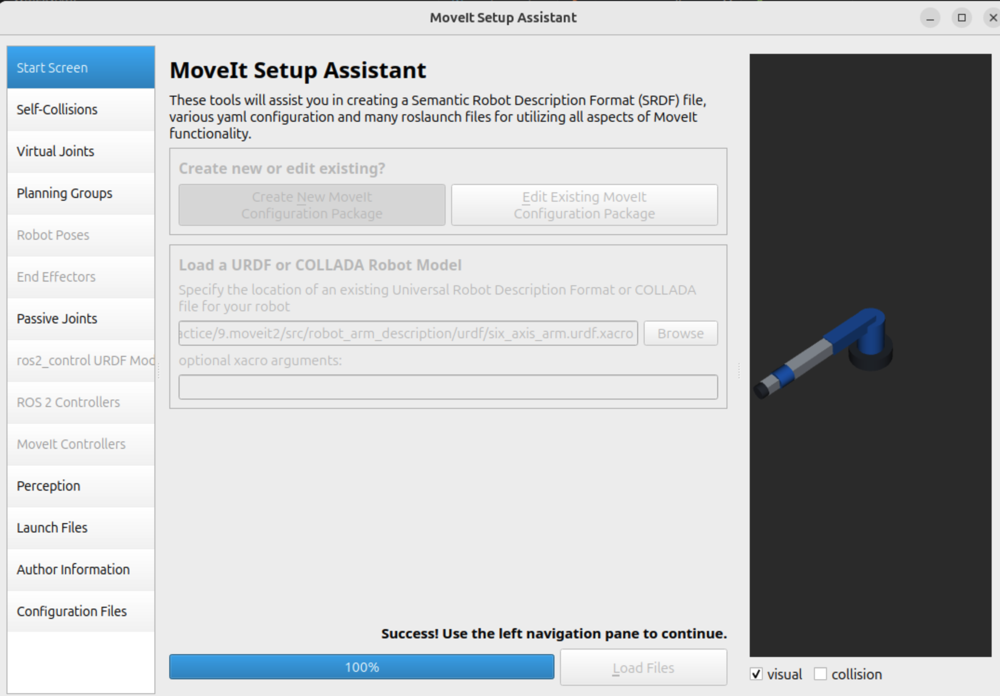
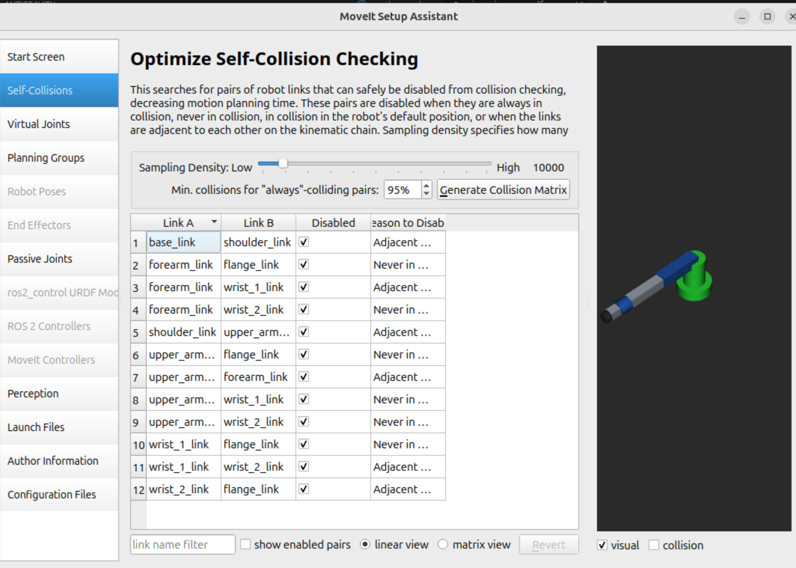
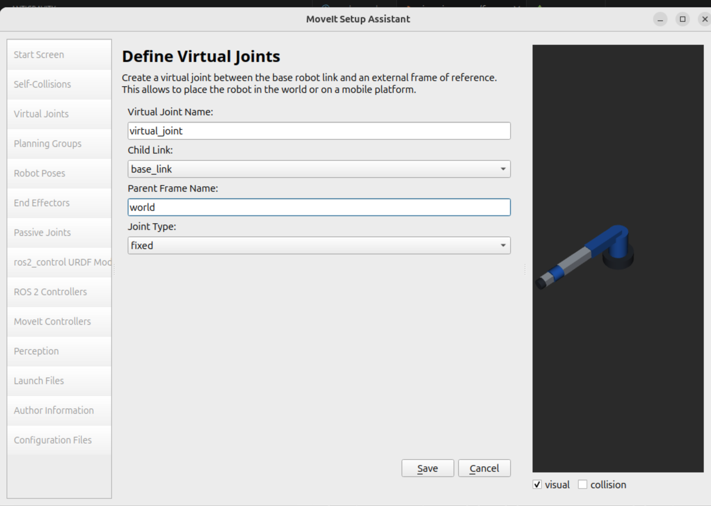
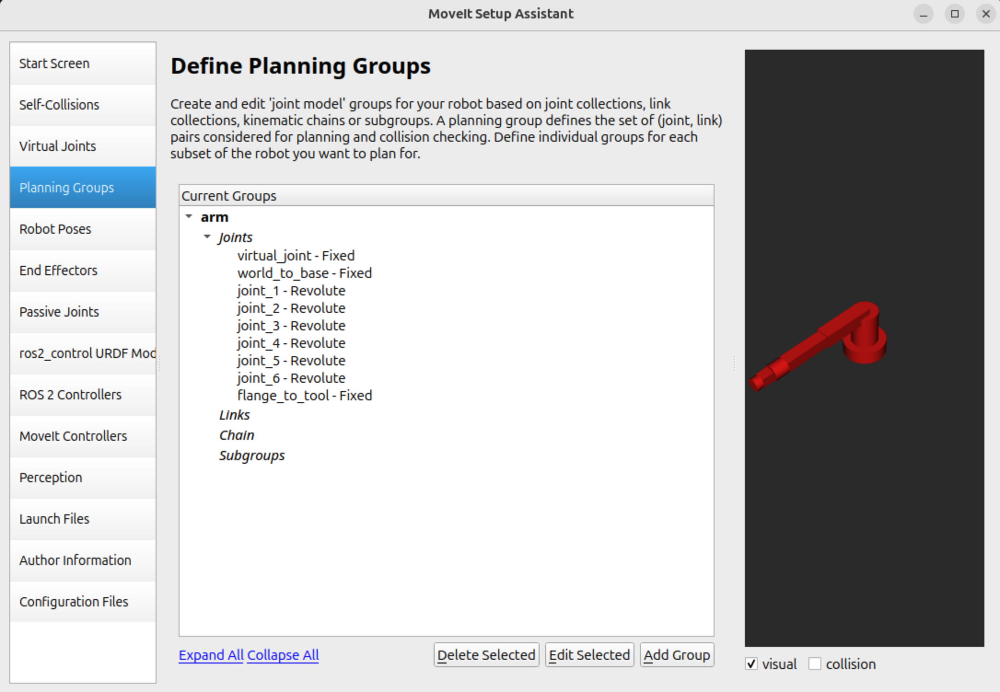
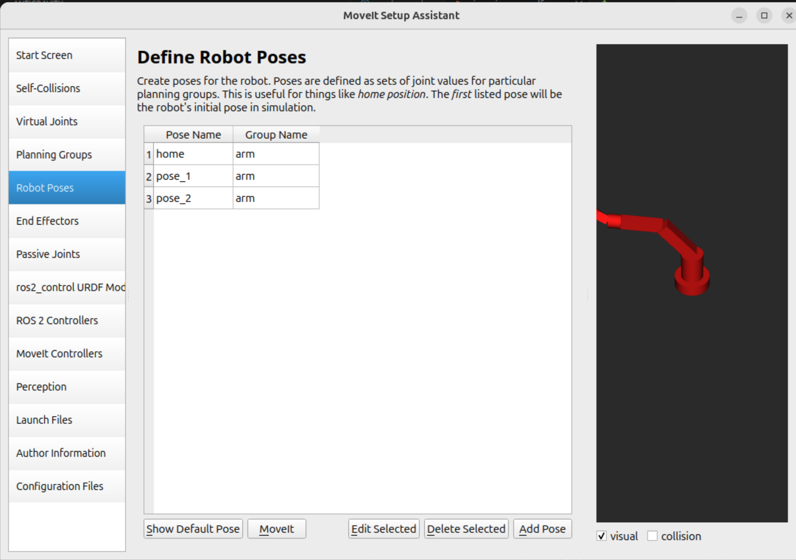
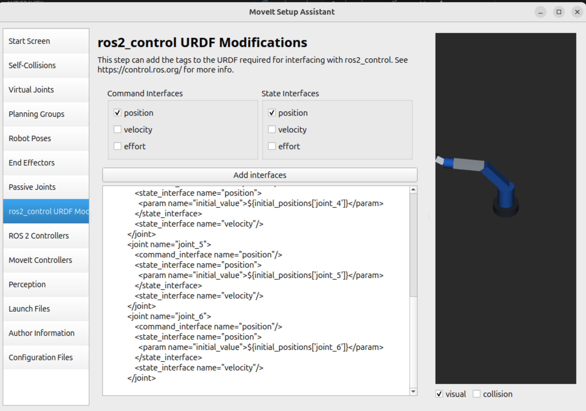
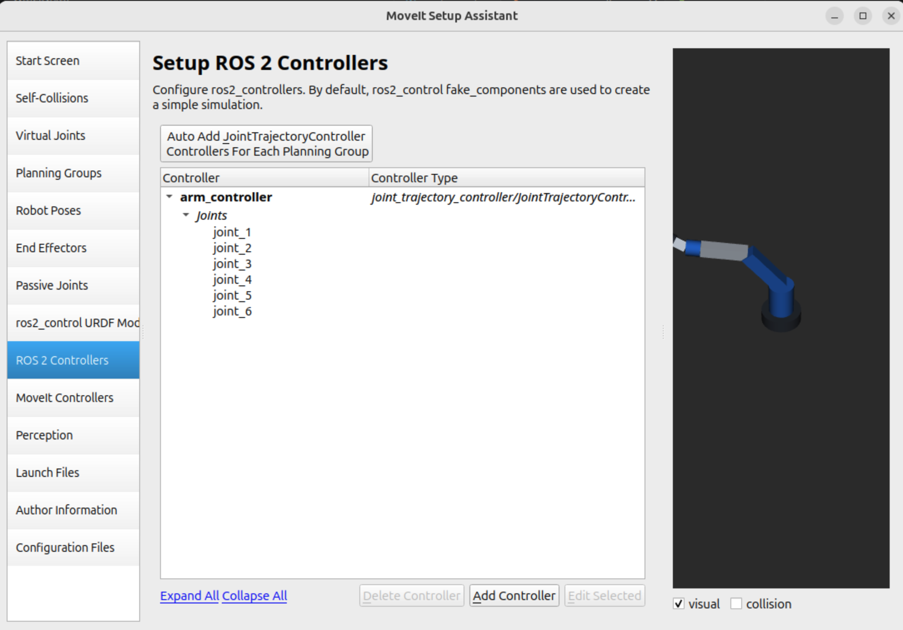
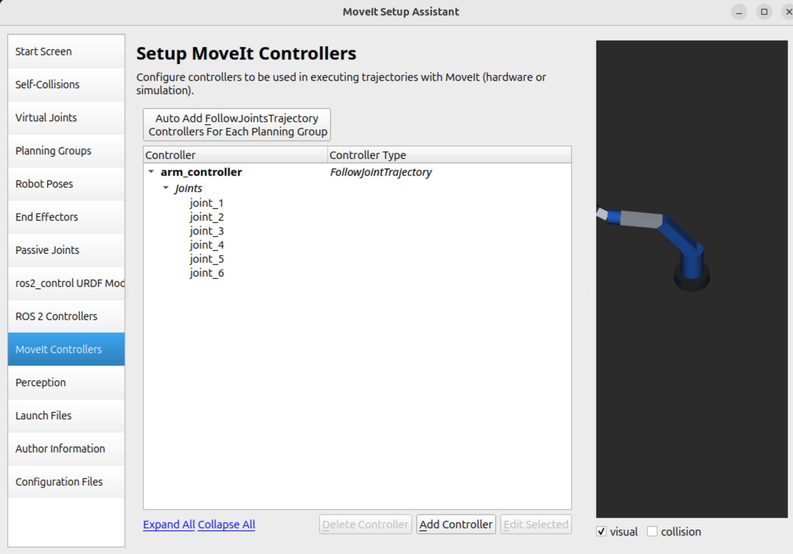
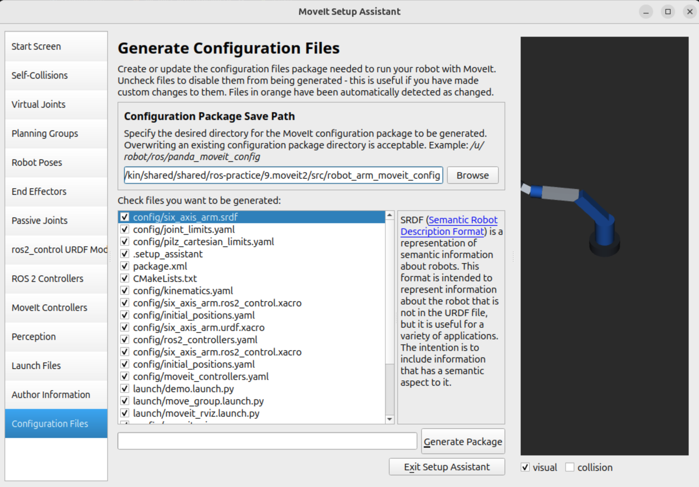

## Install MoveIt2
```
sudo apt install ros-$ROS_DISTRO-rmw-cyclonedds-cpp

gedit ~/.bashrc
# add
export RMW_IMPLEMENTATION=rmw_cyclonedds_cpp

sudo apt install ros-jazzy-moveit
```

## Display the six-axis arm

The `robot_arm_description` package contains a primitive-shape six-axis arm,
including collision geometry, inertial properties, joint limits, and a `tool0`
frame. The joints are base yaw, shoulder pitch, elbow pitch, wrist roll,
wrist pitch, and tool roll. The arm is fixed to `world`.

Edit the named Xacro properties at the top of
`src/robot_arm_description/urdf/six_axis_arm.urdf.xacro` to change link sizes
and masses. Visuals, collisions, centres of mass, inertia tensors, and joint
offsets use these properties. The display launch file expands Xacro automatically.

From `9.moveit2` in a ROS 2 Jazzy terminal:

```bash
source /opt/ros/jazzy/setup.bash
rosdep install --from-paths src --ignore-src -r -y
colcon build --symlink-install --packages-select robot_arm_description
source install/setup.bash
ros2 launch robot_arm_description display.launch.py
```

RViz opens with the robot model and grid. Use the joint state publisher GUI
sliders to move the six joints. Enable the TF display in RViz to inspect frames.
To display the zero pose without sliders:

```bash
ros2 launch robot_arm_description display.launch.py gui:=false
```

This package provides visualization only; MoveIt planning and ros2_control
configuration can be added using the MoveIt Setup Assistant as described below.

---

## Configuring MoveIt 2 with MoveIt Setup Assistant

The MoveIt Setup Assistant is a graphical tool for generating the configuration package (SRDF, controller configurations, kinematics, launch files, etc.) required to use MoveIt 2.

### 1. Launch MoveIt Setup Assistant

From `9.moveit2` in a ROS 2 terminal:

```bash
source /opt/ros/jazzy/setup.bash
source install/setup.bash

# QT_QPA_PLATFORM=xcb ensures reliable GUI rendering across X11 / Wayland environments
QT_QPA_PLATFORM=xcb ros2 launch moveit_setup_assistant setup_assistant.launch.py
```

---

### 2. Step-by-Step Setup Guide

#### Step 1: Start Screen & Load URDF
- Select **Create New MoveIt Configuration Package**.
- Browse to the URDF/Xacro file:
  `src/robot_arm_description/urdf/six_axis_arm.urdf.xacro`
- Click **Load Files** and wait for the robot model to load into the 3D viewer.



#### Step 2: Self-Collisions
- Click **Self-Collisions** on the left pane.
- Keep the default sampling density (or set to High).
- Click **Generate Collision Matrix** to compute and disable collision pairs that are adjacent or never collide.



#### Step 3: Virtual Joints
- Click **Virtual Joints** -> **Add Virtual Joint**.
- Configure:
  - **Virtual Joint Name**: `virtual_joint`
  - **Child Link**: `base_link`
  - **Parent Frame Name**: `world`
  - **Joint Type**: `fixed`
- Click **Save**.



#### Step 4: Planning Groups
- Click **Planning Groups** -> **Add Group**.
- Set **Group Name** to `arm`.
- Kinematic Solver: `kdl_kinematics_plugin/KDLKinematicsPlugin` (default).
- Click **Add Joints** and add:
  - `virtual_joint`
  - `world_to_base`
  - `joint_1` through `joint_6`
  - `flange_to_tool`
- Click **Save**.



#### Step 5: Robot Poses
- Click **Robot Poses** -> **Add Pose**.
- Define preset poses for the `arm` group (e.g., `home`, `pose_1`, `pose_2`) using the joint sliders.
- Click **Save** for each pose.



#### Step 6: ros2_control URDF Modifications
- Click **ros2_control URDF Mod**.
- **Command Interfaces**: Check `position`.
- **State Interfaces**: Check `position` and `velocity`.
- Click **Add interfaces** to generate ros2_control hardware interface tags.



#### Step 7: ROS 2 Controllers
- Click **ROS 2 Controllers**.
- Click **Auto Add JointTrajectoryController Controllers For Each Planning Group** (or add `arm_controller` of type `joint_trajectory_controller/JointTrajectoryController` for `joint_1` to `joint_6`).



#### Step 8: MoveIt Controllers
- Click **MoveIt Controllers**.
- Click **Auto Add FollowJointTrajectory Controllers For Each Planning Group** (sets up `arm_controller` of type `FollowJointTrajectory` for `joint_1` to `joint_6`).



#### Step 9: Author Information & Generate Configuration Files
- In **Author Information**, enter your name and email.
- Click **Configuration Files**.
- Set **Configuration Package Save Path** to:
  `/path/to/ros-practice/9.moveit2/src/robot_arm_moveit_config`
- Click **Generate Package**.
- Click **Exit Setup Assistant** once all files are successfully generated.



---

### 3. Build & Run the Generated MoveIt Package

After generating `robot_arm_moveit_config`, build and run the demo launch file:

```bash
cd 9.moveit2
source /opt/ros/jazzy/setup.bash
colcon build --symlink-install --packages-select robot_arm_moveit_config
source install/setup.bash

# Launch MoveIt 2 demo with RViz motion planning display and fake controllers
ros2 launch robot_arm_moveit_config demo.launch.py
```

To edit the generated configuration at any time:

```bash
QT_QPA_PLATFORM=xcb ros2 launch moveit_setup_assistant setup_assistant.launch.py
```
Select **Edit Existing MoveIt Configuration Package** and choose `src/robot_arm_moveit_config`.
